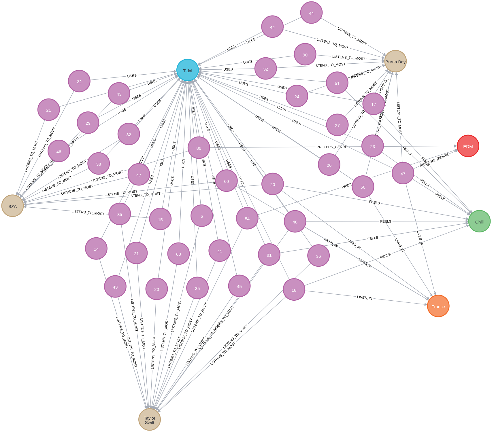
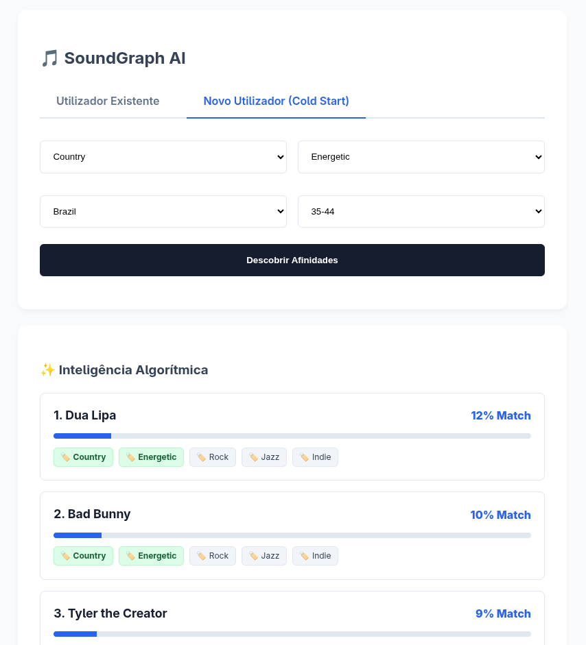

# 🎵 SoundGraph AI Engine


O **SoundGraph AI** é um motor de recomendação musical híbrido alimentado por banco de dados orientados a grafos (Neo4j). Ele utiliza a topologia de conexões entre usuários, gêneros, humores, países e faixas etárias para inferir afinidades musicais com alta precisão e transparência.

## 🏗 Arquitetura e Stack Tecnológica

O projeto foi concebido sob o padrão de **Monólito Modular** guiado pelos princípios da *Clean Architecture*, aderindo estritamente ao Manual da Stack Python Moderna.

*   **Core:** Python >= 3.10 com tipagem estrita (`Strict Typing`).
*   **API & Web:** `FastAPI` utilizando `AsyncIO` nativo para altíssima concorrência. Injeção de Dependências feita via `Annotated`.
*   **Validação de Contratos:** `Pydantic v2` para DTOs (Data Transfer Objects), garantindo a sanitização no momento em que o payload toca a API (evitando erros `422 Unprocessable Entity` em tempo de execução).
*   **Padrões de Projeto:**
    *   **Repository Pattern:** Isola as consultas diretas ao banco de dados (ex: `UserRepository`, `MetadataRepository`).
    *   **Strategy Pattern:** Encapsula os algoritmos complexos de IA, permitindo rotear a inteligência para Usuários Existentes (`HybridRecommendationStrategy`) e Novos Usuários (`ColdStartStrategy`) sem acoplamento.
*   **Persistência:** `Neo4j` (Cypher) atuando como motor de inferência relacional e cálculo probabilístico central.

---

## 🕸 O Modelo de Grafos (Topologia)

A inteligência do algoritmo deriva de como os dados estão conectados, e não apenas de como estão armazenados.


### Evolução do Grafo e Explainable AI
Para viabilizar a **IA Explicável (Explainable AI)**, executamos queries de mutação no grafo para categorizar dados brutos em "nós condensadores". Isso previne a esparsidade da rede.


**Script Cypher para Agrupamento Etário e Inferência de Tags de Artistas:**
```cypher
// 1. Criar e ligar nós de Grupo Etário (Densificação do Grafo)
MATCH (u:User)
WITH u,
     CASE
       WHEN u.age < 18 THEN 'Sub-18'
       WHEN u.age <= 24 THEN '18-24'
       WHEN u.age <= 34 THEN '25-34'
       WHEN u.age <= 44 THEN '35-44'
       ELSE '45+'
     END AS faixa
MERGE (ag:AgeGroup {name: faixa})
MERGE (u)-[:BELONGS_TO_AGE_GROUP]->(ag);

// 2. Taguear Artistas com Gênero e Humor baseando-se em seus ouvintes
MATCH (u:User)-[:LISTENS_TO_MOST]->(a:Artist)
MATCH (u)-[:PREFERS_GENRE]->(g:Genre)
MERGE (a)-[:HAS_GENRE]->(g);
```

---

## 🚀 O Desafio do Novo Usuário (Cold Start) e a Solução

### O Problema: "Nenhuma tribo encontrada"
Em sistemas de recomendação clássicos, um novo usuário sem histórico de navegação não possui "vizinhança", tornando impossível a Filtragem Colaborativa tradicional.

Inicialmente, tentamos forçar o usuário a pertencer a uma "Tribo" de ouvintes preexistentes utilizando uma intersecção estrita de características (Gênero **E** Humor **E** País **E** Idade). No entanto, como o grafo em estágios iniciais é esparso, o excesso de especificidade resultava em respostas vazias.

### A Solução: Fuzzy Matching e Matemática de Grafos
Através de um ciclo de refatoração baseado no framework mental *ReAct* (Reasoning and Acting), substituímos a idade exata pela **Faixa Etária** predefinida e implementamos o **Fuzzy Matching** (Afinidade Parcial) na nossa query Cypher de *Cold Start*.

Em vez de exigir 100% de match, o algoritmo agora aprova vizinhos cuja similaridade cruzada obedece à equação:
$$Afinidade \ge 2$$
(Ou seja, se o vizinho compartilhar pelo menos metade das 4 características demográficas e comportamentais).

**A Query Cypher de Afinidade Parcial:**
```cypher
// Coleta os nós de interesse do payload do Pydantic
MATCH (n) WHERE
  (n:Genre AND n.name = $genre) OR
  (n:Mood AND n.name = $mood) OR
  (n:Country AND n.name = $country) OR
  (n:AgeGroup AND n.name = $age_group)
WITH collect(n) AS target_nodes

// Fuzzy Matching: Localiza vizinhos com afinidade >= 2 pontos de contato
MATCH (vizinho:User)-[r]->(trait)
WHERE trait IN target_nodes
WITH vizinho, count(r) AS afinidade
WHERE afinidade >= 2

// Calcula probabilidade de Match (%) baseada na tribo gerada
// ... (retorna o match_percentage)
```

### Inteligência Explicável na Interface
No Front-End (desenvolvido em Vanilla JS para máxima performance), o motor cruza as características enviadas pelo usuário com as tags de IA retornadas pelo backend. As etiquetas matemáticas coincidentes recebem um *highlight verde* automático, respondendo visualmente ao usuário o porquê de ele estar recebendo aquela recomendação.



---

## ⚙️ Como Executar Localmente

**1. Pré-requisitos:**
* Instalar o `uv` (Gestor de dependências ultra-rápido).
* Docker (Para instanciar o Neo4j).

**2. Iniciando o Banco de Dados:**
```bash
docker run -d --name soundgraph-db \
  -p 7474:7474 -p 7687:7687 \
  -e NEO4J_AUTH=neo4j/minhasenha123 \
  neo4j:latest
```

**3. Executando a API e a Interface:**
No diretório raiz do projeto, inicie o servidor de alta performance Uvicorn:
```bash
uv run uvicorn src.main:app --host 0.0.0.0 --port 8080 --reload
```
Acesse o sistema no navegador: `http://localhost:8080`.